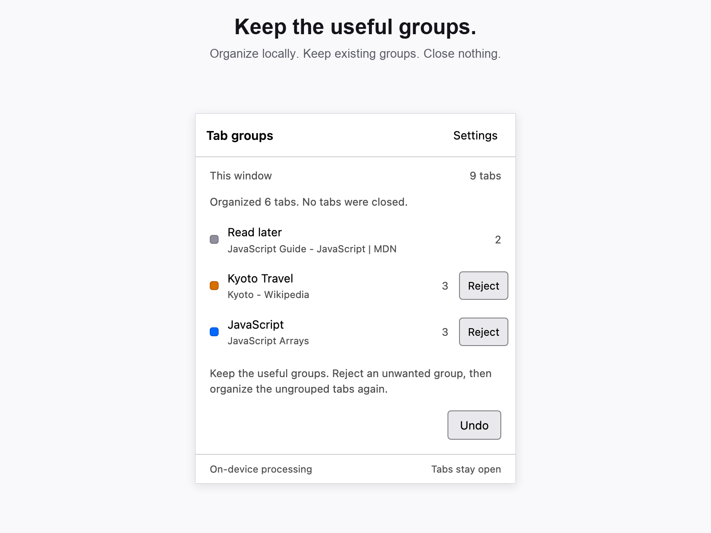

# Thread — AI Tab Groups

**AI tab grouping for Firefox, on your device.** Thread uses local AI to find related tabs and name native Firefox groups—without an account, API key, or cloud inference.

- **Group with AI:** turn related research and work tabs into recognizable groups.
- **Keep your structure:** preserve existing groups, manual corrections, pinned tabs, and Firefox container boundaries.
- **Stay in control:** reject individual groups, undo, or adjust the grouping style and retry. No tabs are automatically closed.

AI grouping is imperfect; uncertain tabs can stay loose, and generated names can need correction. English titles work best.



[Reject and retry](docs/images/02-reject.png) · [On-device settings](docs/images/03-settings.png) · [Screenshot provenance](docs/images/README.md) · [Support / issues](https://github.com/smitp/thread-tab-group/issues)

**Pre-release:** the Mozilla Add-ons listing remains a draft, not submitted or published. Build and load the unsigned extension temporarily using the instructions below.

## Run it

Requires desktop Firefox **140+**, including Firefox 140 ESR, with native tab groups enabled, and Node.js 22+. **Nightly, Firefox AI availability, and AI preference flags are not required.**

```sh
npm ci
npm run build
```

1. Open `about:debugging#/runtime/this-firefox` in Firefox.
2. Select **Load Temporary Add-on…** and choose **`dist/manifest.json`**.
3. Pin Thread from Firefox's extensions menu, then click its toolbar icon.
4. Click **Organize tabs** and allow model-download access. Local activity learning is optional and off by default. The bundled local AI works without Firefox AI permission.

**Enable Firefox AI (optional)** is a separate action on the first-use screen and in Settings. Firefox requires `trialML` to be requested alone, not together with download-host access. Declining it, an unavailable API, or a loaded manifest that does not declare it never blocks local setup.

First use may download approximately **85 MB** of model files from Mozilla and Hugging Face. Firefox may also download its inference runtime. Models are cached locally; their hosts receive download requests, not tab information. The bundled fallback includes its own runtime code and has a separate model cache, so falling back can require an additional download. A first download needs an internet connection. English group names work best.

Already using Thread? **Settings → Enable Firefox AI (optional)** requests the native permission without resetting your groups or activity-learning choice. Otherwise the existing local implementation continues working.

Updating a temporary installation? Use **Reload** for Thread in `about:debugging`, or load the new **`dist/manifest.json`** again. Refreshing the popup alone does not reload the manifest.

Temporary add-ons are removed when Firefox restarts. This build is unsigned; permanent installation in standard Firefox requires Mozilla signing.

To produce unsigned extension and source ZIPs on macOS/Linux (requires the `zip` command):

```sh
npm run package
```

Outputs: **`artifacts/thread-firefox-0.2.1.zip`** and **`artifacts/thread-source-0.2.1.zip`** (matching reviewer source). Packaging overwrites these versioned files, so preserve any previously submitted archives before running it again.

The build needs no account, secret, or model download. npm dependencies are pinned in `package-lock.json`. To reproduce an extension from its source archive, run `npm ci` and `npm run build` in a clean directory, then compare the files in `dist/` with the extension ZIP's contents. ZIP timestamps and compression may differ.

First-party code and original artwork are [MIT licensed](LICENSE). Dependency and model licenses are listed in [third-party notices](public/THIRD_PARTY_NOTICES.txt). The icon's vector source and store exports are in `assets/`; installed icons and light/dark toolbar variants are in `public/icons/`. See the [privacy disclosure](docs/privacy.md) for data handling and controls.

Thread is independent of Mozilla. Its public name is **Thread — AI Tab Groups**; the preserved 0.2.1 package uses **Thread — Tab groups** internally and retains the same stable extension ID.

## Use

- Click the toolbar icon to organize the current window directly. The compact **Tab groups** panel uses system colors/fonts and standard controls, without a branded dashboard. Native Firefox groups remain the main interface.
- Click a group to expand it and activate its most recently accessed surviving tab.
- Your existing groups guide organization. Clear site, repository/path, or semantic project matches can join them; specific scopes beat broad site rules. Shared-host products such as Google Docs and Sheets remain distinct. Names, colors, and existing members stay intact. Equally plausible groups and intent labels such as “Read later” are not guessed.
- Move tabs and rename groups using Firefox's normal controls. Thread respects observed corrections, including ungrouping tabs from user-created groups.
- **Reject** an unwanted, unchanged Thread-created group directly from its list row. Its tabs ungroup **in place** and stay open; useful groups and unrelated manual exclusions remain intact. Click **Organize ungrouped tabs** to include those released tabs on the next deliberate pass. Reopening the panel alone does not regroup them.
- Rejected combinations are remembered locally using opaque tab identities (up to 50 per window). New groups and appends cannot put all those members together again, including inside a larger group. Smaller/different combinations are allowed; this is not a promise that every new suggestion will be relevant. Closing a member or manually regrouping the combination clears its feedback when observed. Rejection works with activity learning off.
- **Undo** reverses the last organization where safe. New tabs are not closed, closed tabs are not reopened, and subsequently modified groups are left alone.
- To redo the entire latest run rather than one group: **Undo → choose More focused / Balanced / Broader → Organize again**. The latest Undo’s restored tabs are explicitly included; unrelated manual exclusions remain protected. Reopening the panel after Undo waits for this choice instead of immediately organizing again.
- **Grouping style** adjusts new-group thresholds, not matching rules for existing groups. More focused can leave marginal tabs ungrouped; broader accepts looser relationships. A changed style does not guarantee a different result, and rerunning identical inputs/settings is not a random reshuffle. The last selected style is remembered per window.
- **Include N excluded tabs** is on the main panel. It explicitly reconsiders eligible tabs you previously left out, without erasing learned connections. Older exclusions that predate the new Undo retry metadata remain here rather than being silently reclassified.
- Settings lets you opt in/out of activity learning or clear learned relationships. No-change results distinguish uncertain matches, exclusions, protected/absent eligible tabs, and tabs that changed during analysis.

Pinned, hidden, playing/sharing tabs and private windows are not organized. Normal organization never moves existing members out or merges groups; only eligible loose tabs can be appended. Explicit Reject ungroups only unchanged Thread-created groups whose members are eligible; manually created/corrected groups are protected. Hidden and mixed-container groups are not destinations. Different Firefox containers are kept separate. Uncertain tabs remain ungrouped. There is no automatic background rearrangement.

Stopping analysis prevents tab changes and keeps exclusions/retry eligibility intact. Firefox's trial ML API cannot cancel an already-started native download/inference: it may finish in the background, but cancelled results are discarded.

If Firefox interrupts the extension, the next opening reports that interruption. Changes are journaled before application so Undo can attempt safe recovery. Rejection has a separate journal and **Finish rejection** action; it does not overwrite other groups’ Undo steps. This is not a backup of page contents or unsaved forms. Other extensions that move or hide tabs can conflict; concurrent tab managers are not certified compatible.

## Privacy

Tab titles, group names, and minimized address information are processed locally. No page content, cookies, browsing history, screenshots, or keystrokes are read. Thread sends no analytics or telemetry. Firefox's native runtime follows Firefox's own diagnostic and download settings; Thread does not change those settings.

Optional activity learning stores up to 500 tab-to-tab relationships on the device, only in windows where you use Thread. Relationships expire after seven days and are pruned when the extension runs; closed-tab links are removed when observed. Turning learning off clears them. Group identities/membership, manual exclusions, and the latest Undo record are stored locally separately, including existing user groups in windows where Thread is used. The current grouping style, opaque identities of Undo/rejection-released tabs, and bounded rejected-combination feedback are also stored per window. Explicit rejection feedback is separate from passive activity learning and never contains stored model inputs. Organizational preferences are inferred from current groups even with activity learning off; no separate site-preference profile is stored. Thread's inference-text caches are memory-only and cleared after inactivity. Firefox manages the native engine's lifetime.

The `sessions` permission is used to attach stable opaque identities to tabs/windows across Firefox session restore. Thread does not call the closed-history or session-restore APIs. Download-host permission is requested on first use; `trialML` is an independent optional request; there is no broad website-content permission. Firefox AI can be declined or its permission revoked in Firefox's extension settings; the bundled local path remains available.

## Support

Report bugs, ask questions, or suggest improvements through [GitHub Issues](https://github.com/smitp/thread-tab-group/issues). Include your Firefox and extension versions, reproduction steps, and a non-sensitive example when possible. Issues are public: do not post private tab titles or addresses, personal information, credentials, or confidential security details.

## Implementation boundaries

- `src/core/`: browser-independent grouping, continuity, validation, and recovery.
- `src/ai/`: replaceable inference interfaces, native/local selection, pinned models, and bundled worker embeddings/naming.
- `src/platform/firefox/`: native APIs, optional Firefox embedding runtime, stable identities, storage, permissions, and messaging.
- `src/ui/`: compact toolbar experience.

Only Firefox is implemented. `npm run build` checks TypeScript and bundles the extension. No automated test suite is included.

Models are pinned in `src/ai/models.ts`:
- `Xenova/all-MiniLM-L6-v2` (Apache-2.0) supplies embeddings.
- `Mozilla/smart-tab-topic` (MPL-2.0) generates group names.

Optional Firefox embeddings use Mozilla's versioned `Xenova/all-MiniLM-L6-v2/v0.1.0` mirror. Native output is validated before use; unavailable or incompatible inference falls back to the bundled local worker. Naming always uses the bundled worker. Model output is data: deterministic code validates and applies browser changes.

Known add-on lint warnings concern escaped dynamic popup markup, ONNX's dynamic import of the packaged local runtime, and an Android-only minimum-version warning for the data-collection declaration. This extension supports desktop Firefox only. A successful build or lint run does not establish grouping quality or complete browser compatibility.
